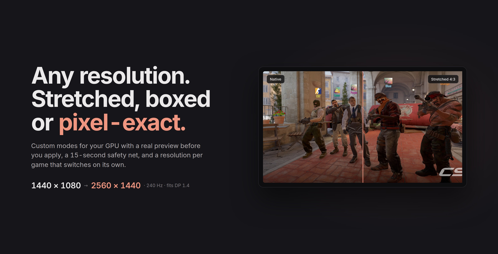
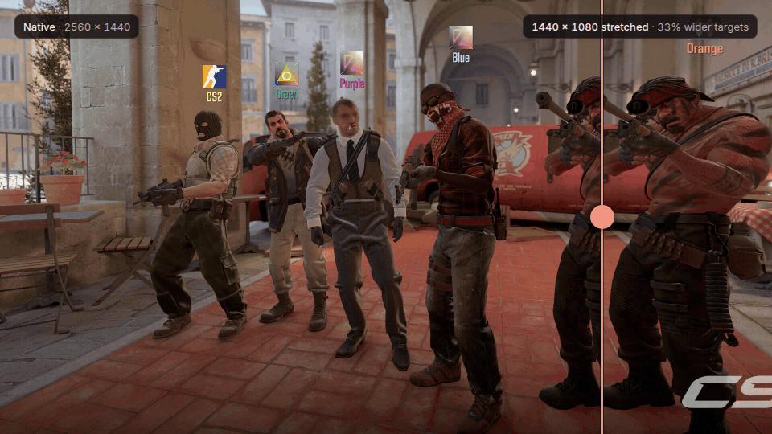
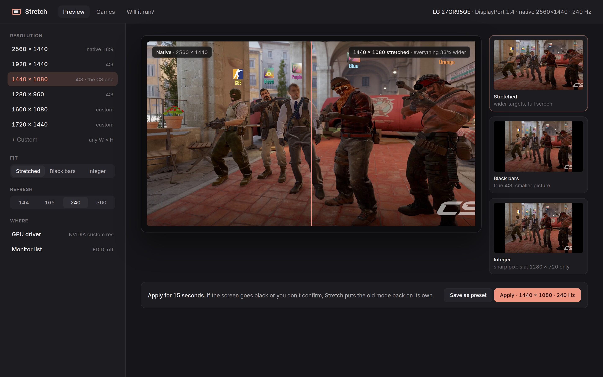
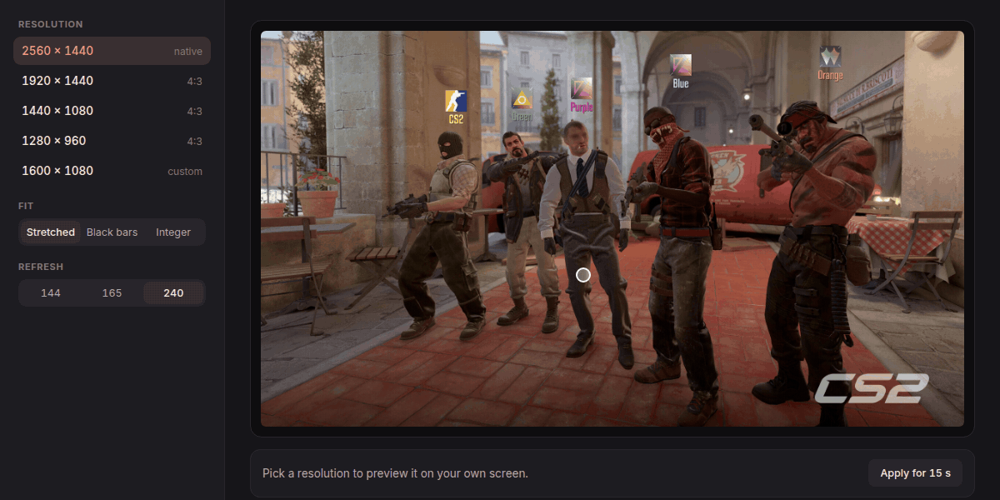
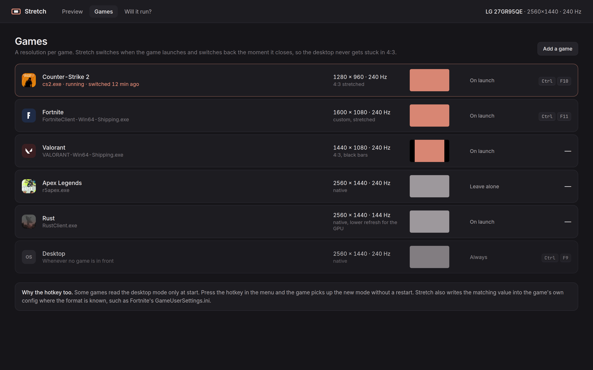
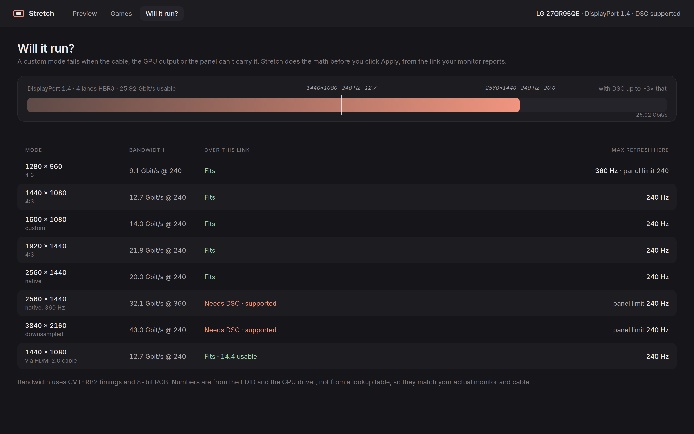

# Stretch — custom resolution tool with stretched 4:3 preview

  
  
  
  

<h2 align="center">Stretch</h2>

<b>Custom resolutions with a real preview before you apply, a 15-second safety net, a bandwidth check for your cable, and a resolution per game that switches on its own.</b>

<b>Free · Windows 10 and 11 · open source.</b> <b>v1.2.6 is out now</b> — grab it from <a href="releases/latest">Releases</a>.

## See it work

The same frame, native on one side and stretched on the other. Player models are a third wider, which is the whole reason people play stretched.

## What Stretch will do

- Adds custom resolutions through the GPU driver (NVIDIA, AMD, Intel) without touching the monitor's EDID, with an EDID override as an opt-in.
- Previews the mode on a capture of your own screen: native and stretched side by side, plus black bars and integer scaling.
- Applies every mode with a 15-second safety net that restores the old mode if the screen goes black or you do not confirm.
- Keeps one resolution per game, such as 1280×960 stretched for Counter-Strike 2 or 1600×1080 for Fortnite, and switches on launch and back on exit.
- Computes bandwidth per mode from the EDID and the active DisplayPort or HDMI link, including whether DSC is needed and supported.
- Offers hotkeys for games that read the display mode only at start.

## Why not just CRU

Custom Resolution Utility is great and a little scary: you edit an EDID override, reboot the driver, and hope the screen comes back. Stretch is the version you'd hand to a friend.

- **See it first.** The preview shows your real screen, split native and stretched, and all three fits side by side.
- **Can't brick the display.** Every apply is held for 15 seconds. No confirmation, or a black screen, and the old mode comes back on its own.
- **Will it run?** Bandwidth is computed from your monitor's EDID and the link the GPU reports, so a mode that won't fit is flagged before you click.
- **A resolution per game.** 1280×960 for Counter-Strike, 1600×1080 for Fortnite, native for everything else. Switched on launch, back on exit.

## Screens

### Preview

Pick a resolution, a fit and a refresh. The frame is a capture of what is on screen now, so you judge the stretch on your own game, not on a diagram.

Pick, preview, apply, keep. If you never click Keep, the old mode comes back by itself.

### Games

The desktop never gets stuck in 4:3. Hotkeys exist for games that read the mode only at start.

### Will it run?

The reason custom modes fail is almost always the link. Stretch does the CVT-RB2 math per mode and tells you the real ceiling, including when DSC is needed and whether the monitor has it.

## How it will work

1. Read the EDID and the active link (DisplayPort or HDMI version, lane count, DSC) from the display driver.
2. Add modes through the GPU vendor's custom resolution path (NVIDIA, AMD, Intel), which leaves the monitor's own list alone. An EDID override stays available as an opt-in for stubborn setups.
3. Apply with a timed revert, the same way Windows confirms a display change.
4. Watch process launches and switch modes per game, with the previous mode restored on exit, crash or sign-out.

## FAQ

**Can this damage my monitor?**
A mode the monitor can't show gives a black screen, not damage. Stretch checks bandwidth first and reverts on its own after 15 seconds.

**Does stretched res work in Fortnite?**
Fortnite needs the resolution in its own config as well as on the desktop. Stretch writes both and restores both.

**NVIDIA, AMD or Intel?**
All three are planned, each through the vendor's own custom resolution path.

**Do I still need CRU?**
Only for unusual cases such as editing detailed timings by hand. For adding a resolution and using it per game, no.

## Get it

Download [`stretch-custom-resolution.zip`](releases/latest) — v1.2.6, Windows 10 and 11. Unpack the folder and start `Stretch.exe`.

## Roadmap

- [x] Brand, icon and screens
- [ ] EDID and link reader
- [ ] Driver custom modes for NVIDIA, AMD and Intel
- [ ] Preview with live capture and the three fits
- [ ] Timed apply with revert
- [ ] Per-game rules and hotkeys

## Credits

Screens show a screenshot and library art from Counter-Strike 2 (Valve), library art from Apex Legends (Electronic Arts) and Rust (Facepunch Studios), and the Fortnite (Epic Games) and Valorant (Riot Games) marks, to show how a real stretched mode looks. These belong to their owners and are not part of this project. The design scripts fetch them from Steam and Simple Icons at render time; none are stored in the repo. Stretch's own code, brand and screens are [MIT](LICENSE).

## About this repo

**Description:** Custom resolution tool with live preview: stretched 4:3, black bars or integer scaling, 15-second revert, per-game resolution switching, cable bandwidth check.

**Topics:** custom-resolution, stretched-resolution, stretched-res, cru, display-settings, 4-3, fortnite, cs2, windows
